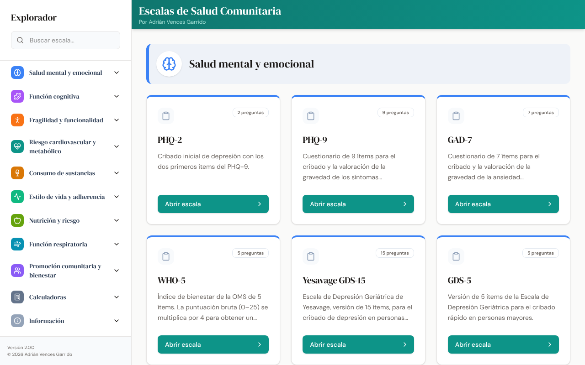
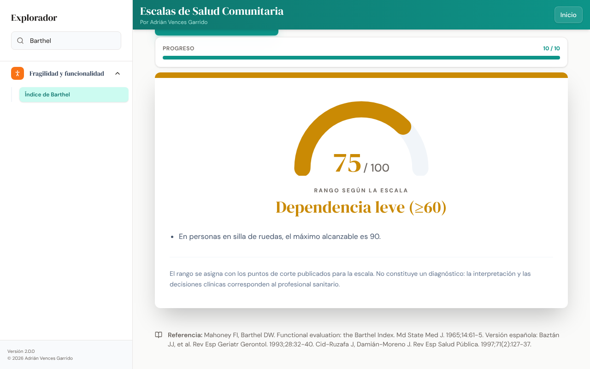

# Escalas de Salud Comunitaria

[](https://github.com/adrian-ai-salud/escalas-salud-comunitaria-app/actions/workflows/ci.yml)
[](https://adrian-ai-salud.github.io/escalas-salud-comunitaria-app/)
[](LICENSE)
[](CHANGELOG.md)

Aplicación web con escalas y cuestionarios de uso habitual en atención primaria y en enfermería familiar y comunitaria. Calcula la puntuación, muestra el rango que la literatura asigna a cada escala y cita su referencia bibliográfica.

**[Abrir la aplicación](https://adrian-ai-salud.github.io/escalas-salud-comunitaria-app/)**



## Características

- 32 escalas clínicas y 5 calculadoras, organizadas por áreas.
- Puntos de corte de las publicaciones originales o de la validación española, con la referencia visible en cada escala.
- Alertas de seguridad, como el ítem 9 del PHQ-9.
- Funciona en el navegador, en ordenador y en móvil. No envía ni guarda las respuestas.
- Pruebas automáticas que comprueban la puntuación de todas las escalas en cada cambio.



## Aviso

- No es un producto sanitario. No emite diagnósticos ni recomendaciones de tratamiento: la interpretación y las decisiones clínicas corresponden al profesional.
- Las escalas pertenecen a sus autores. Se reproducen con su cita para uso clínico y docente no comercial. Algunas tienen condiciones propias: Mini-Cog © S. Borson; CAT © GlaxoSmithKline; MNA® Nestlé; MUST © BAPEN; DAST-10 © H. A. Skinner.

## Escalas incluidas

### Salud mental y emocional

- **PHQ-2**. Kroenke K, Spitzer RL, Williams JB. The Patient Health Questionnaire-2: validity of a two-item depression screener. Med Care. 2003;41(11):1284-92.
- **PHQ-9**. Kroenke K, Spitzer RL, Williams JB. The PHQ-9: validity of a brief depression severity measure. J Gen Intern Med. 2001;16(9):606-13. Versión española: Diez-Quevedo C, et al. Psychosom Med. 2001;63(4):679-86.
- **GAD-7**. Spitzer RL, Kroenke K, Williams JB, Löwe B. A brief measure for assessing generalized anxiety disorder: the GAD-7. Arch Intern Med. 2006;166(10):1092-7. Versión española: García-Campayo J, et al. Health Qual Life Outcomes. 2010;8:8.
- **WHO-5**. Topp CW, Østergaard SD, Søndergaard S, Bech P. The WHO-5 Well-Being Index: a systematic review of the literature. Psychother Psychosom. 2015;84(3):167-76.
- **Yesavage GDS-15**. Sheikh JI, Yesavage JA. Geriatric Depression Scale (GDS): recent evidence and development of a shorter version. Clin Gerontol. 1986;5:165-73. Versión española: Martínez de la Iglesia J, et al. Medifam. 2002;12(10):620-30.
- **GDS-5**. Hoyl MT, Alessi CA, Harker JO, et al. Development and testing of a five-item version of the Geriatric Depression Scale. J Am Geriatr Soc. 1999;47(7):873-8.

### Función cognitiva

- **Mini-Cog**. Borson S, et al. The Mini-Cog: a cognitive "vital signs" measure for dementia screening in multi-lingual elderly. Int J Geriatr Psychiatry. 2000;15(11):1021-7. Mini-Cog © S. Borson: uso clínico y docente; no puede modificarse ni usarse con fines comerciales sin permiso del autor.
- **Test de Pfeiffer (SPMSQ)**. Pfeiffer E. A short portable mental status questionnaire for the assessment of organic brain deficit in elderly patients. J Am Geriatr Soc. 1975;23(10):433-41. Versión española: Martínez de la Iglesia J, et al. Med Clin (Barc). 2001;117(4):129-34.
- **Test del reloj (a la orden)**. Cacho J, García-García R, Arcaya J, Vicente JL, Lantada N. Una propuesta de aplicación y puntuación del test del reloj en la enfermedad de Alzheimer. Rev Neurol. 1999;28(7):648-55.

### Fragilidad y funcionalidad

- **FRAIL**. Morley JE, Malmstrom TK, Miller DK. A simple frailty questionnaire (FRAIL) predicts outcomes in middle aged African Americans. J Nutr Health Aging. 2012;16(7):601-8.
- **Índice de Barthel**. Mahoney FI, Barthel DW. Functional evaluation: the Barthel Index. Md State Med J. 1965;14:61-5. Versión española: Baztán JJ, et al. Rev Esp Geriatr Gerontol. 1993;28:32-40. Cid-Ruzafa J, Damián-Moreno J. Rev Esp Salud Pública. 1997;71(2):127-37.
- **Escala de Lawton y Brody (AIVD)**. Lawton MP, Brody EM. Assessment of older people: self-maintaining and instrumental activities of daily living. Gerontologist. 1969;9(3):179-86.
- **Batería corta de desempeño físico (SPPB)**. Guralnik JM, Simonsick EM, Ferrucci L, et al. A short physical performance battery assessing lower extremity function. J Gerontol. 1994;49(2):M85-94. Ministerio de Sanidad. Documento de consenso sobre prevención de la fragilidad en la persona mayor. Actualización 2022.
- **Test de la silla (30 segundos)**. Jones CJ, Rikli RE, Beam WC. A 30-s chair-stand test as a measure of lower body strength in community-residing older adults. Res Q Exerc Sport. 1999;70(2):113-9. Rikli RE, Jones CJ. J Aging Phys Act. 1999;7(2):162-81.

### Riesgo cardiovascular y metabólico

- **FINDRISC**. Lindström J, Tuomilehto J. The diabetes risk score: a practical tool to predict type 2 diabetes risk. Diabetes Care. 2003;26(3):725-31.
- **REGICOR**. Marrugat J, Solanas P, D'Agostino R, et al. Estimación del riesgo coronario en España mediante la ecuación de Framingham calibrada. Rev Esp Cardiol. 2003;56(3):253-61. Marrugat J, et al. J Epidemiol Community Health. 2007;61(1):40-7.
- **SCORE2 / SCORE2-OP**. SCORE2 working group and ESC Cardiovascular risk collaboration. Eur Heart J. 2021;42(25):2439-54. SCORE2-OP working group. Eur Heart J. 2021;42(25):2455-67.
- **Índice de Comorbilidad de Charlson**. Charlson ME, Pompei P, Ales KL, MacKenzie CR. A new method of classifying prognostic comorbidity in longitudinal studies. J Chronic Dis. 1987;40(5):373-83. Charlson M, et al. Validation of a combined comorbidity index. J Clin Epidemiol. 1994;47(11):1245-51.

### Consumo de sustancias

- **AUDIT-C**. Bush K, Kivlahan DR, McDonell MB, et al. The AUDIT alcohol consumption questions (AUDIT-C). Arch Intern Med. 1998;158(16):1789-95. Versión española: Gual A, Segura L, Contel M, et al. Alcohol Alcohol. 2002;37(6):591-6.
- **Test de Fagerström**. Heatherton TF, Kozlowski LT, Frecker RC, Fagerström KO. The Fagerström Test for Nicotine Dependence. Br J Addict. 1991;86(9):1119-27. Versión española: Becoña E, Vázquez FL. Psychol Rep. 1998;83(3 Pt 2):1455-8.
- **DAST-10**. Skinner HA. The Drug Abuse Screening Test. Addict Behav. 1982;7(4):363-71 (© 1982 Harvey A. Skinner; uso no comercial con cita del autor). Versión española: Pérez Gálvez B, et al. Salud y drogas. 2010;10(1):35-50.

### Estilo de vida y adherencia

- **IPAQ-SF (versión corta)**. Craig CL, Marshall AL, Sjöström M, et al. International Physical Activity Questionnaire: 12-country reliability and validity. Med Sci Sports Exerc. 2003;35(8):1381-95. IPAQ Research Committee. Guidelines for data processing and analysis of the IPAQ, 2005.
- **Cuestionario de conducta sedentaria (SBQ)**. Rosenberg DE, Norman GJ, Wagner N, et al. Reliability and validity of the Sedentary Behavior Questionnaire (SBQ) for adults. J Phys Act Health. 2010;7(6):697-705.
- **Morisky-Green**. Morisky DE, Green LW, Levine DM. Concurrent and predictive validity of a self-reported measure of medication adherence. Med Care. 1986;24(1):67-74. Versión española: Val Jiménez A, et al. Aten Primaria. 1992;10(5):767-70.
- **Adherencia a la dieta mediterránea (MEDAS-14)**. Schröder H, Fitó M, Estruch R, et al. A short screener is valid for assessing Mediterranean diet adherence among older Spanish men and women. J Nutr. 2011;141(6):1140-5. Martínez-González MA, et al. PLoS One. 2012;7(8):e43134.

### Nutrición y riesgo

- **MNA-SF (Mini Nutritional Assessment, forma corta)**. Rubenstein LZ, et al. Screening for undernutrition in geriatric practice: developing the short-form MNA (MNA-SF). J Gerontol A Biol Sci Med Sci. 2001;56(6):M366-72. Kaiser MJ, et al. J Nutr Health Aging. 2009;13(9):782-8. MNA® Société des Produits Nestlé SA.
- **MUST (Malnutrition Universal Screening Tool)**. Elia M. The "MUST" report. Nutritional screening of adults: a multidisciplinary responsibility. BAPEN; 2003. «MUST» reproducido con permiso de BAPEN.
- **NRS-2002 (Nutritional Risk Screening)**. Kondrup J, Rasmussen HH, Hamberg O, Stanga Z; ESPEN. Nutritional risk screening (NRS 2002): a new method based on an analysis of controlled clinical trials. Clin Nutr. 2003;22(3):321-36.

### Función respiratoria

- **CAT (COPD Assessment Test)**. Jones PW, Harding G, Berry P, et al. Development and first validation of the COPD Assessment Test. Eur Respir J. 2009;34(3):648-54. CAT © GlaxoSmithKline.
- **Escala de disnea mMRC**. Bestall JC, Paul EA, Garrod R, et al. Usefulness of the Medical Research Council (MRC) dyspnoea scale as a measure of disability in patients with COPD. Thorax. 1999;54(7):581-6.

### Promoción comunitaria y bienestar

- **Duke-UNC-11 (apoyo social funcional)**. Bellón JA, Delgado A, Luna JD, Lardelli P. Validez y fiabilidad del cuestionario de apoyo social funcional Duke-UNC-11. Aten Primaria. 1996;18(4):153-63.
- **EAT-26 (Eating Attitudes Test)**. Garner DM, Olmsted MP, Bohr Y, Garfinkel PE. The Eating Attitudes Test: psychometric features and clinical correlates. Psychol Med. 1982;12(4):871-8. Versión española: Castro J, Toro J, Salamero M, Guimerá E. Evaluación Psicológica. 1991;7:175-90.

### Calculadoras

- **Índice de masa corporal (IMC)**. World Health Organization. Obesity: preventing and managing the global epidemic. WHO Technical Report Series 894. Ginebra: WHO; 2000.
- **Aclaramiento de creatinina (Cockcroft-Gault)**. Cockcroft DW, Gault MH. Prediction of creatinine clearance from serum creatinine. Nephron. 1976;16(1):31-41.
- **Gasto energético basal (Harris-Benedict)**. Harris JA, Benedict FG. A biometric study of human basal metabolism. Proc Natl Acad Sci USA. 1918;4(12):370-3.
- **Peso ideal (Lorentz)**. Lorentz FH. Ein neuer Konstitutionsindex. Klin Wochenschr. 1929;8:348-51.
- **Interpretación de bioimpedancia**. Grasa corporal: Gallagher D, Heymsfield SB, Heo M, et al. Healthy percentage body fat ranges. Am J Clin Nutr. 2000;72(3):694-701. Resto de parámetros: rangos orientativos de fabricantes de básculas de bioimpedancia.

## Desarrollo

Requisitos: [Node.js](https://nodejs.org/) 22 o superior.

```sh
npm install
npm start           # servidor de desarrollo en http://localhost:9005
npm test            # pruebas de puntuación de todas las escalas
npm run typecheck   # comprobación de tipos
npm run build       # versión para publicar, en build/
```

### Estructura

```
src/
  scales/        una escala por archivo, con su referencia
  components/    interfaz (React + Tailwind CSS)
  config.ts      versión, autor y enlaces de contacto
tests/           pruebas automáticas (Vitest)
.github/         integración continua, publicación y plantillas
```

## Publicación

Cada cambio en `main` se prueba y se publica automáticamente en GitHub Pages. El contenido de `build/` es una web estática que también puede subirse a cualquier alojamiento, incluida una subcarpeta.

## Contribuir

Las correcciones con fuente son bienvenidas. Consulte [CONTRIBUTING.md](CONTRIBUTING.md) y use las plantillas de incidencias.

## Cómo citar

Vences Garrido A. Escalas de Salud Comunitaria (versión 2.0.0) [software]. 2026. Disponible en: https://github.com/adrian-ai-salud/escalas-salud-comunitaria-app

Los metadatos están en [CITATION.cff](CITATION.cff).

## Autor

**Adrián Vences Garrido**, enfermero especialista en Enfermería Familiar y Comunitaria
[adrianvencesgarrido.com](https://adrianvencesgarrido.com/) · [ORCID 0009-0001-2460-9318](https://orcid.org/0009-0001-2460-9318) · [LinkedIn](https://www.linkedin.com/in/adrianvencesgarrido/)

## Licencia

Código con licencia MIT (ver [LICENSE](LICENSE)). La licencia no se extiende a los instrumentos clínicos, cuyos derechos corresponden a sus autores.
